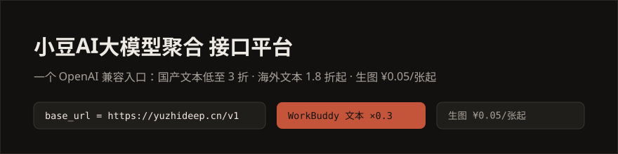

# 小豆AI大模型聚合 接口平台 · API 接入文档

> 一个 OpenAI 兼容入口，调用 GLM、DeepSeek、Kimi 等 63 个在售模型：国产模型官方价 **5 折**，海外文本 **1.8 折起**，生图低至 **¥0.05/张**。

<p align="center">
  
</p>

**价格一眼看完**：国产模型官方价 **5 折** ｜ 海外文本低至官方价 **1.8 折（0.18 倍，比官方直连便宜 82%）** ｜ 生图 **¥0.05/张起** ｜ 视频 **¥2.25/条起** ｜ 免费模型 `hy4flash-free` **¥0**

> 价格口径以本页为准：海外文本是**官方价的 0.18 倍**，不是加价；旧版文档里的海外加价写法已作废。

**直接找**：[30 秒接入](#30-秒接入) ｜ [导入 CC Switch](#导入-cc-switchclaude-code--codex) ｜ [支持哪些模型](#支持哪些模型) ｜ [价格怎么算](#价格怎么算) ｜ [接口清单](#接口清单) ｜ [错误码](#错误码与排查) ｜ [常见问题](#常见问题)

> 控制台（注册 / 令牌 / 额度）：<https://yuzhideep.cn/login> ｜ 充值：<https://yuzhideep.cn/topup/>
>
> API Base URL：`https://yuzhideep.cn/v1` ｜ 文档更新：2026-11-22

---

## 这个平台是什么

小豆AI大模型聚合 接口平台是宇智人工智能（深圳）有限公司运营的大模型 API 聚合服务（业内也叫「大模型中转站」「AI API 中转」）：开发者只用**一个 OpenAI 兼容地址** `https://yuzhideep.cn/v1` 和一枚 `sk-` 开头的令牌，就能调用 GLM、DeepSeek、Kimi 等国产模型与部分海外模型；平台按 token、按张或按条计费：**国产模型按厂商公开挂牌价 5 折**、**海外文本低至官方价 1.8 折（0.18 倍）**、**生图低至 ¥0.05/张**；密钥、额度、限速与调用明细都在网页控制台管理。

它解决的是一个很具体的问题：同时用三四家模型时，每家一套密钥、一套计费、一套 SDK、一套错误码；换模型要改代码，对账要开四张表。把 `base_url` 指向本平台后，换模型只改 `model` 一个字段，账单也只有一份。

## 一分钟看清

| 项 | 值 |
| --- | --- |
| 产品名 | 小豆AI大模型聚合 接口平台 |
| 运营主体 | 宇智人工智能（深圳）有限公司 |
| 站点 / 控制台 | <https://yuzhideep.cn/> ｜ <https://yuzhideep.cn/login> |
| API Base URL | `https://yuzhideep.cn/v1` |
| 协议 | OpenAI Chat Completions（`POST /v1/chat/completions`）、模型列表（`GET /v1/models`） |
| 鉴权 | 请求头 `Authorization: Bearer sk-...` |
| 计费单位 | 人民币 / 100 万 tokens，输入与输出分别计价 |
| 国产模型价格 | 厂商公开挂牌价 **×0.5**（5 折） |
| 海外文本价格 | 官方价 **1.8 折起（0.18 倍）**（示例：`gpt-6-sol` 官方 $2/$10 → 本站 ¥2.60/1M 起） |
| 生图价格 | **¥0.05/张起**（`gpt-image-2.6-flare`） |
| 视频价格 | **¥2.25/条起**（`seedance-2.0-mini-5s`） |
| 注册方式 | 邮箱 + 邮箱验证码，不需要手机号 |
| 默认限速 | 每令牌 **60 次/分钟** |
| 支持能力 | 流式输出（SSE）、多轮上下文、工具调用（以模型支持为准）、OpenAI SDK |
| 客户端导入 | CC Switch 一键导入 Claude Code / Codex（密钥列表行末「⋯」→「CC Switch」） |
| 计费口径 | 以控制台「模型广场」公示为准；上游调价时平台同步调整并公告 |
| 本仓定位 | 公开接入文档（内容 CC BY 4.0，示例代码 MIT） |

## 30 秒接入

```bash
# 1) 注册并创建令牌：https://yuzhideep.cn/login  →  「令牌」页生成 sk-...
export XIAODOU_API_KEY="sk-你的令牌"

# 2) 发第一条请求：只改 base_url，其余与 OpenAI 一致
curl https://yuzhideep.cn/v1/chat/completions \
  -H "Authorization: Bearer $XIAODOU_API_KEY" \
  -H "Content-Type: application/json" \
  -d '{
    "model": "deepseek-v4.1-flash",
    "messages": [{"role": "user", "content": "用一句话解释什么是 SSE"}],
    "stream": false
  }'
```

返回是标准 OpenAI 结构：

```json
{
  "id": "chatcmpl-...",
  "object": "chat.completion",
  "model": "deepseek-v4.1-flash",
  "choices": [
    { "index": 0, "message": { "role": "assistant", "content": "SSE 是……" }, "finish_reason": "stop" }
  ],
  "usage": { "prompt_tokens": 18, "completion_tokens": 36, "total_tokens": 54 }
}
```

三种语言的完整示例在 [`examples/`](./examples/)：`curl.sh`、`python_openai_sdk.py`、`node_openai_sdk.mjs`、`python_stream.py`。

## 导入 CC Switch（Claude Code / Codex）

CC Switch 是管理 Claude Code / Codex 供应商的开源工具（[ccswitch.io](https://ccswitch.io)）。本平台已内置导入入口：

1. 登录控制台，在「令牌 / API Keys」页新建一枚 `sk-` 令牌。
2. 在令牌行末点「⋯」→「CC Switch」，选 **Claude Code** 或 **Codex** 与主模型。
3. 浏览器唤起 CC Switch 后，核对地址与打码后的 Key，点「导入」。

没有装 CC Switch 的，先下载安装；也可以打开 <https://yuzhideep.cn/ccswitch/> 粘贴令牌，生成 `ccswitch://` 导入链接（Key 只在浏览器本地拼接，不上传服务器）。

- Claude Code 用本平台的 Claude 系列模型可直接选；用 GLM、DeepSeek 等非 Claude 模型时，选对应模型即可。
- Codex 建议选 `gpt-6-sol` 或 `gpt-6.1-sol`。
- 原生深链接不带余额查询脚本，卡片上不显示余额；余额以控制台为准。

## 支持哪些模型

当前可用模型以控制台「模型广场」为准，也可以用接口自己拉：

```bash
curl https://yuzhideep.cn/v1/models -H "Authorization: Bearer $XIAODOU_API_KEY"
```

公开价目示例（2026-11-22 从控制台公开价目读回；共 63 个在售模型）：

**国产模型：官方价 ×0.5**（人民币 / 100 万 tokens，入 / 出）

| 模型 | 官方价 | 小豆价 |
| --- | --- | --- |
| `deepseek-v4.1-flash` | ¥0.40 / ¥1.60 | **¥0.20 / ¥0.80** |
| `deepseek-v4-pro` | ¥1.80 / ¥5.40 | **¥0.90 / ¥2.70** |
| `glm-5.3` | ¥4.16 / ¥14.56 | **¥2.08 / ¥7.28** |
| `glm-5.3-flash` | ¥0.416 / ¥1.456 | **¥0.208 / ¥0.728** |
| `kimi-k3` | ¥8.00 / ¥40.00 | **¥4.00 / ¥20.00** |
| `kimi-k3.1-pro` | ¥5.20 / ¥27.20 | **¥2.60 / ¥13.60** |
| `hy4flash` | ¥0.26 / ¥0.76 | **¥0.13 / ¥0.38** |
| `hy4flash-free` | 上游免费 | **¥0** |

**海外文本：官方价 1.8 折起（0.18 倍）**

| 模型 | 官方价（USD / 100 万 tokens，入 / 出） | 本站起价（CNY / 100 万 tokens） | 约折扣 |
| --- | --- | --- | --- |
| `gpt-6-sol` | $2 / $10 | **¥2.60** | 1.8 折 |
| `claude-opus-5.5` | $4 / $20 | **¥7.00** | 2.4 折 |
| `claude-haiku-5.5` | $0.1 / $0.5 | **¥0.26** | 3.6 折 |
| `claude-fable-5` | $3 / $15 | **¥17.50** | 8.0 折 |

**生图：按张**

| 模型 | 价格 |
| --- | --- |
| `gpt-image-2.6-flare` | **¥0.05/张** |
| `gpt-image-2.5-flare` | ¥0.25/张 |
| `gpt-image-2` | ¥0.40/张 |
| `gpt-image-2.6-sunburst` | ¥0.50/张 |
| `gemini-3.1-flash-image` | ¥0.60/张 |

**视频：按条 / 按秒**

| 模型 | 价格 |
| --- | --- |
| `seedance-2.0-mini-5s` | **¥2.25/条**（¥0.45/秒） |
| `seedance-2.0-5s` | ¥5.25/条（¥1.05/秒） |
| `seedance-2.0-per-video` | ¥10.00/条 |
| `seedance-2.5-per-video` | ¥27.50/条 |

- 表里是**示例**，完整清单、上下文长度、最大输出与实时价格以控制台「模型广场」为准；模型上下架会在控制台与 [CHANGELOG](./docs/changelog.md) 同步。
- 需要某个表里没有的模型，可以在 GitHub Issues 提，或邮件联系。

## 价格怎么算

平台沿用 OpenAI 的计价结构：**输入（prompt）与输出（completion）分开算**，单位是「人民币 / 100 万 tokens」。一次请求的费用＝输入 tokens × 输入单价 ＋ 输出 tokens × 输出单价，按实际用量结算，控制台「日志」页能看到每一笔请求的 tokens 与扣费。

**国产模型 5 折**：把厂商公开挂牌价乘以 0.5 作为本站零售价。半价只动模型倍率，不改输入 / 输出的比例关系，所以长输出与短输出都按同一折扣走。

**四条价轨**：

| 类型 | 怎么算 | 当前公开价（示例） |
| --- | --- | --- |
| 国产文本 | 厂商公开价 ×0.5 | `glm-5.3` ¥2.08 / ¥7.28 |
| 海外文本 | 官方价 1.8 折起（0.18 倍） | `gpt-6-sol` ¥2.60 / 1M tokens 起 |
| 生图 | 按张 | `gpt-image-2.6-flare` ¥0.05/张 |
| 视频 | 按条或按秒 | `seedance-2.0-mini-5s` ¥2.25/条 |

**关于「海外 0.0x 折」**：当前公开价目里最低是 **1.8 折**（`gpt-6-sol`），没有 0.0x 折。低于上游边际成本的价格通常来自订阅额度套利、共享号池或免费额度，断供、封号与请求内容留存风险由调用方承担；若未来接入更低的第三方渠道，会单列分组、标注不承诺 SLA，不写成默认承诺。

**计费边界**（同样写在用户协议里，这里直说）：

- 充值金额兑换为平台配额，配额只用于调用接口，**不可提现、不可转让**；已消耗部分不退款。
- 上游调价、限流或停止服务时，平台可调整模型供给与价格，并尽量提前公告。
- 令牌只限本账号使用；**转售、二次分发或搭建面向公众的同类中转服务需要书面授权**。

## 接口清单

| 方法与路径 | 用途 | 说明 |
| --- | --- | --- |
| `POST /v1/chat/completions` | 对话补全 | 支持 `stream: true`（SSE）、多轮 `messages`、`tools` / `tool_choice`（模型支持时） |
| `GET /v1/models` | 可用模型列表 | 返回当前令牌可访问的模型 ID |
| `GET /v1/dashboard/billing/subscription` | 额度查询 | 兼容 OpenAI 计费查询形态，具体字段以实际返回为准 |

请求体与 OpenAI Chat Completions 一致，常用字段：

| 字段 | 类型 | 说明 |
| --- | --- | --- |
| `model` | string | 必填，模型 ID，见「模型广场」 |
| `messages` | array | 必填，`role` 取 `system` / `user` / `assistant` / `tool` |
| `stream` | boolean | `true` 时按 SSE 逐块返回 `data: {...}`，以 `data: [DONE]` 结束 |
| `temperature` / `top_p` | number | 采样参数，范围与上游一致 |
| `max_tokens` | integer | 最大输出 tokens，受模型上限约束 |
| `tools` / `tool_choice` | array / object | 工具调用，模型支持时生效 |
| `response_format` | object | `{"type":"json_object"}` 等，模型支持时生效 |

鉴权只用请求头，不要把令牌放进 URL 或前端代码：

```http
Authorization: Bearer sk-xxxxxxxx
Content-Type: application/json
```

## 客户端的接法

任何支持「自定义 OpenAI Base URL」的 SDK 或客户端都能接，把地址填成 `https://yuzhideep.cn/v1`、密钥填令牌即可：

| 场景 | 配置 |
| --- | --- |
| OpenAI 官方 SDK（Python / Node） | `base_url` / `baseURL` 指向 `https://yuzhideep.cn/v1` |
| LangChain / LlamaIndex | 用 OpenAI 兼容 LLM 封装，覆盖 base URL |
| Dify / FastGPT / Cherry Studio / Chatbox / NextChat | 模型提供方选「OpenAI 兼容」，填地址与令牌 |
| 自建后端 | 直接 HTTP 调用，保留 `Authorization` 头 |

Python（OpenAI SDK）：

```python
from openai import OpenAI

client = OpenAI(base_url="https://yuzhideep.cn/v1", api_key="sk-你的令牌")
resp = client.chat.completions.create(
    model="glm-5.3",
    messages=[{"role": "user", "content": "把这段话翻译成英文：今天适合写代码。"}],
)
print(resp.choices[0].message.content)
```

Node（openai v4+）：

```js
import OpenAI from 'openai';

const client = new OpenAI({
  baseURL: 'https://yuzhideep.cn/v1',
  apiKey: process.env.XIAODOU_API_KEY,
});

const resp = await client.chat.completions.create({
  model: 'kimi-k3',
  messages: [{ role: 'user', content: '用三句话介绍 SSE。' }],
});
console.log(resp.choices[0].message.content);
```

## 错误码与排查

错误响应沿用 OpenAI 结构：`{"error": {"message": "...", "type": "...", "code": "..."}}`。`type` 可能是 `new_api_error` 或上游透传的类型，**判断以 HTTP 状态码 + `code` 为准**。

| HTTP | 常见 `code` | 含义 | 处理 |
| --- | --- | --- | --- |
| 400 | `invalid_request_error` | 参数缺失或类型不对 | 检查 `model`、`messages` 结构 |
| 401 | `invalid_token` | 令牌无效、被禁用或已过期 | 控制台重新生成令牌 |
| 402 | `insufficient_quota` | 额度不足 | 充值或换用其他令牌 |
| 403 | `model_not_allowed` | 令牌无权访问该模型 | 在令牌设置里放开模型范围 |
| 404 | `model_not_found` | 模型 ID 不存在或已下架 | 拉 `/v1/models` 对照 |
| 429 | `rate_limit_exceeded` | 超过每分钟请求数 | 退避重试（指数退避 + 抖动） |
| 500 | `upstream_error` | 上游返回错误 | 稍后重试；持续出现请带请求 ID 反馈 |
| 503 | `no_available_channel` | 暂无可用渠道 | 换模型或稍后重试 |

排查顺序：① `GET /v1/models` 确认模型存在；② 用最小请求体复现；③ 看控制台「日志」里的状态码与扣费；④ 带上请求时间、模型 ID、HTTP 状态码提 Issue。

## 限速与配额

- 默认 **60 次/分钟 / 令牌**；需要更高并发在控制台或邮件申请。
- 请求体走 HTTPS，服务端限制单请求体积；长文本请自行分段，别把整本书塞进一次请求。
- 上下文长度与最大输出由具体模型决定，超限通常返回 400 或上游错误。
- 平台不承诺 100% 可用：上游中断、限流、内容审核拒绝属于上游行为，按用户协议处理。

## 数据与合规边界

- 请求经平台转发到上游模型服务，返回内容由模型生成；**不要在产品里把生成内容当作事实来源直接展示**，该加免责声明就加。
- **不要在 prompt 里放密码、身份证号、银行卡号、客户名单等敏感个人信息**；确有需要请先脱敏。
- 平台按用户协议与隐私政策处理账号数据与调用记录；协议全文见 <https://yuzhideep.cn/agreement>、<https://yuzhideep.cn/privacy>。
- 生成式 AI 服务受《生成式人工智能服务管理暂行办法》等法规约束；平台可能按法规要求补充身份核验。违规内容与违规用法会被限制或封禁。
- 需要给最终用户直接提供生成式 AI 服务的，请自行评估备案、内容安全与未成年人保护义务。

## 常见问题

**问：小豆AI大模型聚合 接口平台是什么？**
答：它是宇智人工智能（深圳）有限公司运营的大模型 API 聚合服务。开发者用一个 OpenAI 兼容地址 `https://yuzhideep.cn/v1` 和一枚令牌，就能调用 GLM、DeepSeek、Kimi 等模型；平台按 token 分别计算输入与输出费用，国产模型按厂商公开价 5 折计费，密钥、额度与调用明细在网页控制台管理。

**问：和直接买官方 API 有什么区别？**
答：直连官方拿到的是厂商 SLA、官方发票与全部模型；接聚合平台拿到的是「一个地址、一份账单、随时换模型」，代价是多一跳网络与对平台稳定性的依赖。预算敏感、想快速对比多家模型时用聚合更省事；对合规审计、发票、独享配额有硬要求时，直连官方更合适。两边可以并存。

**问：国产模型 5 折是真的吗？怎么算？**
答：是真的，按厂商公开挂牌价 ×0.5 计费，输入与输出同折扣，单位是人民币 / 100 万 tokens。例如 `glm-5.3` 官方挂牌 ¥4.16 / ¥14.56，本站 ¥2.08 / ¥7.28。最终扣费以控制台「日志」里的实际 tokens 为准。

**问：海外模型有 0.0x 折吗？**
答：当前公开价目里没有。海外文本最低 **1.8 折（官方价 0.18 倍）**：`gpt-6-sol` 官方 $2/$10 → 本站 ¥2.60/1M 起；生图最低 **¥0.05/张**（`gpt-image-2.6-flare`）。价格随上游调整，以控制台「模型广场」为准；若未来接入更低的第三方渠道，会单列并标注不承诺 SLA。

**问：支持 OpenAI 官方 SDK 吗？**
答：支持。把 `base_url` 改成 `https://yuzhideep.cn/v1`、`api_key` 填令牌即可，其余代码不用动。流式、工具调用、多轮上下文按模型能力工作。

**问：会不会记录我的对话？**
答：请求要经过平台转发到上游，链路上必然处理请求内容。**不要把敏感个人信息写进 prompt**；账号数据与调用记录的处理方式以用户协议和隐私政策为准。对数据驻留有硬要求的场景，请直连你信任的官方端点。

**问：怎么充值与查额度？**
答：登录控制台 <https://yuzhideep.cn/login>，在充值页 <https://yuzhideep.cn/topup/> 充值，额度与每笔扣费在「日志」页可见。配额不可提现、不可转让。

**问：限速多少？**
答：默认每令牌 60 次/分钟。批量任务请做客户端并发控制与指数退避，别用固定间隔死重试。

**问：支持发票、对公转账吗？**
答：以控制台当前展示与企业对接口径为准；有对公、发票或合同需求，发邮件到 <contact@yuzhideep.com> 说明用量与主体信息。

**问：出问题去哪儿反馈？**
答：在本仓提 [Issue](https://github.com/xiaodou-official/xiaodou-llm-api/issues)，或邮件 <contact@yuzhideep.com>。带上请求时间、模型 ID、HTTP 状态码与错误 `code`，能省一轮往返。

## 同主体的其他产品

小豆是宇智人工智能（深圳）有限公司的产品品牌，现役三条产品线，钱路与合规主体相同，账号与计费各自独立：

| 产品 | 做什么 | 入口 | 公开资料 |
| --- | --- | --- | --- |
| **小豆AI大模型聚合 接口平台** | 一个 OpenAI 兼容入口调用多家大模型 | <https://yuzhideep.cn/> | 本仓 ｜ [Gitee 镜像](https://gitee.com/lu-wulei/xiaodou-llm-api) |
| **小豆支付开放平台** | 已有系统的商家把支付宝 / 微信收款接进自己的系统 | <https://xdfair.cn/> | [GitHub](https://github.com/xiaodou-official/xiaodou-open-platform) ｜ [Gitee](https://gitee.com/lu-wulei/xiaodou-open-platform) |
| **小豆集市** | 不用写代码，上架数字商品就能开卖 | <https://xdjishi.cn/> | [GitHub](https://github.com/xiaodou-official/xiaodou-market) ｜ [Gitee](https://gitee.com/lu-wulei/xiaodou-market) |

- 品牌总站（三条线的入口与备案信息）：<https://www.xiaodouap.cn/>
- App 端产品说明：<https://github.com/xiaodou-official/xiaodou-app>
- 接入文档网页版：<https://www.xiaodouap.cn/llm-api/>

## 版本与许可

- 文档版本：v1.0.0（2026-11-22 首次公开发布）。变更见 [CHANGELOG](./docs/changelog.md)。
- 内容许可：**CC BY 4.0**（[LICENSE](./LICENSE)）；示例代码：**MIT**（[LICENSE-CODE](./LICENSE-CODE)）。
- 发布参数与快照方式：见 [PUBLISHING.md](./PUBLISHING.md)。
- 「小豆」「小豆AI大模型聚合」是宇智人工智能（深圳）有限公司的品牌；文档可整段引用，请保留出处链接。
